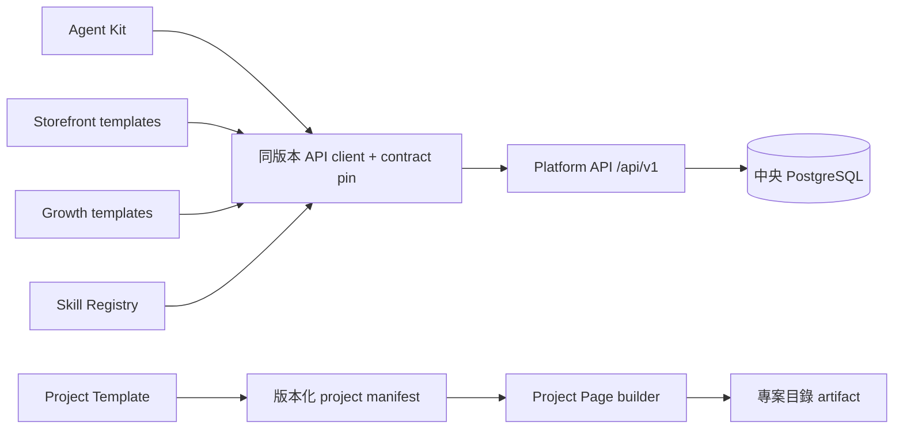

# Repo 分工與模板串接

目前依大計畫 §4 分倉：中央 domain commands 與資料保留在 Platform；可維護／fork 的產品模板獨立。會員定位、供貨與 Guild 不各複製一套 DB。

| Repo | 本輪內容／資料接點 |
| --- | --- |
| freedom-platform | 會員、定位、公會、供貨、零售、作品、行銷 canonical commands；32 個 preview operations、OpenAPI／SDK 及中央 PostgreSQL |
| freedom-agent-kit | 共用 protocol／client、CLI 會員工作摘要、各 AI 工具 adapter 說明；不複製工作資料 |
| freedom-storefront | master-store／catalog-store／single-product／service-offer 模板，店主 API helper、靜態內部預覽；service-offer API 尚未接入 |
| freedom-growth-automation | 草稿／分享 API helper、來源固定的文案與 LINE 格式本機預覽；正式發布／media 執行待接 |
| freedom-skill-registry | declaration index、文件型 skill starter、GitHub project import client；不是第二份會員／作品 DB |
| freedom-project-template | 新專案可運行骨架、測試與身分初始化指引 |
| freedom-project-page | 公開 manifest 的固定介紹頁 builder；不宣稱 signed status／official |
| FreeTWAI.github.io | 九倉專案目錄來源與靜態 build；2026-10-13 repo 改名後 Pages 設定為 `https://freetwai.github.io/`，目錄內容與跨倉來源更新仍需另行驗證 |
| .github | 社群模板、共用驗證 workflow；中央 ruleset 強制執行尚未配置，不宣稱已有管理員 gate |



## 可重跑的串接

Core 的 `tests/integration/repositories.test.ts` 啟動真正的 HTTP API 與唯一 PostgreSQL 測試 schema，再從其他 repo 匯入它們自己的 SDK/helper，驗證選品→供貨回覆、商品→行銷來源、作品→行銷版本與介紹頁。GitHub 對外 response 在該 suite 用明示 fixture；不能把這個 fixture 稱為 provider live 驗收。另已有 staging 真 GitHub import 證據。

```sh
npm run contracts:build
npm test
FREEDOM_REPOSITORIES_ROOT=/absolute/path/to/consumer-checkouts node scripts/checkout-repositories.mjs
FREEDOM_REPOSITORIES_ROOT=/absolute/path/to/consumer-checkouts npm run test:repos
```

`repositories.lock.json` 記錄跨倉實測的 exact commits；CI 下載固定 commits，不能偷偷測各倉最新 main。Consumer `contracts.lock.json` 反向 pin 中央協定的確切 commit/hash；支援程式與事件 schema 都只有一處 authoring source。

跨倉 workspace helper 的 `Promise.all` 可以先因一個 request 失敗而 reject，
其他 SDK operations 仍在執行。Integration harness 以
`tests/integration/helpers/request-drain.ts` 追蹤完整 SDK call（包含送出前與 body parse）
及真正 server handler，在 case 結束、下一次 `TRUNCATE` 前與 suite teardown 時等到
兩端都清空。只等 fetch headers 或只看當下 server handlers 都不足以隔離：
caller abort 後 SQL 可能還沒結束，另一個 call 也可能尚未 dispatch。
清空用的 settlement 不會改變原 caller 的錯誤或把失敗 case 轉成成功；
不以 sleep、deadlock retry、改產品 auth lock 或更新 consumer pins 代替隔離。

## Auth 與副作用邊界

32-operation preview SDK 仍使用會員 session；Node demo login 只接受 HTTP loopback 及已播種的三個假帳號，CLI 不輸出 session cookie／CSRF。2026-09-23 另已加入 [外部客戶端讀取接線](client-read-connections.md)：商店／供應端經本人在平台批准取得七天、可撤銷的 scoped bearer，只讀核准資源，不可寫入、讀會員聯絡或當 browser session。這兩種接線要分清楚。瀏覽器仍沿用同源 Portal，不放寬 CORS。完整 Store purpose token、Agent ExecutionGrant 與 growth leased Job API 仍待開發，不能拿會員 demo session 當 production service account。

寫入需本人已有 authority、明確重送 key 與原版本。409／412 要重新讀取確認；來源 snapshots 不被後續供貨改價或 GitHub 更新覆寫。事件 transport、provider publication、結帳與金流沒有因檔案放入 repo 就啟用。

各 repo 使用真實 GitHub repository／owner ID；copy template 後必須重新初始化 project identity。程式碼授權目前 NOASSERTION，沒有本輪自行新增的授權條款。公開 source、template flag、CI green 和 official／正式發布是不同事實。

## 2026-10-14 發布觀察

選定安全來源 `938516ee` 已在 staging 部署並完成限定驗收，schema166 是原有 ledger，
本次沒有重套 migration。部署前備份的同 set 還原恢復與部署後 `e9ac7afd` 完整還原
均已通過；原失敗保留，staging 日常備份 dispatcher 已於10月14日20:29 UTC 切換。

10月15日既有 staging timer 的 `fc39f036` 另於04:59 UTC capture失敗；05:04 UTC
唯讀對帳確認零殘留、兩個政策開關關閉且59個 reference pins 保留。這不改寫上述
`e9ac7afd` 的完整還原成功；新的 staging operator 修正僅備妥，尚未執行或安裝。
Production 的 fresh before-set `87ec37e7` 已驗證；10月15日03:20 UTC 確認166 COMMIT，
原不變表 assertion 失敗經唯讀對帳收斂為264／266表相同、兩個背景 telemetry 表例外。
政策、RLS、權限與獨立記錄的10項座標 constraints 已核對；沒有重跑SQL或宣稱所有 writer 停止。
03:30 UTC 相容938已部署，正式路由與原 cron 恢復；公開端點、匿名權限／Origin、
資產 bytes 與 live floor 限定驗收通過，未執行正式會員登入／browser／OAuth。
Production after-backup `480cd1f2` dump逾時失敗，後續已獨立確認該次資源清理；
第二次 `28c818b7` 也在含 Docker啟動的production專用300秒預算逾時後失敗，
04:09 UTC 已獨立對帳零殘留資源。
原失敗收據均保留，沒有完整 production after-restore。04:15 UTC 已可回復地切換
production dispatcher 至原 canonical166 adapter，明列 after-backup待完成，未放寬實際
backup／restore／cleanup gates，staging與timers不變。既有 timer 的 `19f7e10e` 確認使用938／
原166 adapter，仍於04:43 UTC capture失敗；180秒預算約72秒耗在容器準備，實際dump約109秒
後被終止。04:46 UTC 獨立對帳零殘留、政策關閉且pins保留；原失敗保留，三次after均未完成還原。

05:06 UTC 啟動一次經審查的 production `e021ebfc`：容器準備移到 capture 前，
實際 dump仍保留180秒、核心流程1200秒上限。6,229,149 bytes的 DB dump、47個物件
與遠端讀回完成，但05:24 UTC 在restore階段失敗，原 `cleanupVerified=false` 保留。
05:29 UTC 獨立唯讀對帳確認該set零殘留容器／volume／DB session／dump client，
兩個政策開關關閉且47個 reference pins保留；沒有重新capture或宣稱還原成功。
本節營運證據截止於這次對帳；4份原失敗保留，修正版尚未安裝到日常 dispatcher，
完整 production after-restore仍未完成。
04:07 UTC 的21筆新座標、零舊座標
觀察仍無部署後同步紀錄；provider scheduled 紀錄停在03:20，04:10–04:21 雖有295次
成功 HTTP，卻無 scheduled 事件。04:33 UTC 一次移除並立即恢復原 cron 的請求已接受，
版本／路由不變。04:53 UTC 補驗確認自然 scheduled 成功、feed watermark 推進至04:50:21，
21／21筆新座標 repo 已同步、零舊座標／錯誤。部署 binding 與獨立 traffic 版本仍為24c6／938，
scheduled資料集本身沒有版本欄位。自然同步限定驗收通過，不代替真人 OAuth／webhook 驗收。
精確來源、實際備份、locale-only browser 補驗與未驗項見
[具日期發布收據](../platform-plan/execution/unified-foundation/rollout-security-2026-10-14.json)
與[現況快照](../platform-plan/execution/unified-foundation/current-state.json)。
main `efaf314d` 已包含 #658／#659，另有 #680 後續批次；這些來源與 AR167 不包含在938發布。

#680 舊 head `93c6dc3f` 的第二次 Verify仍失敗：runtime分區3只完成55／62檔
後逾時，已完成830案例零失敗且清理通過，仍不是整套成功。Browser原兩個失敗案例
已通過，但供貨案例 `hosted-supply-catalog.spec.ts:436` 單案120秒逾時；原 trace未保留，
不能判定是哪個操作卡住，也不能直接歸類偶發。新候選保留原作者與既有3支PR範圍，
補上有界CI容量、去重與診斷改善，仍須 fresh review及新 head完整checks；舊結果不改綠。
10月15日04:38 UTC 直接讀回確認 Agent Kit／Storefront 的 main 均受 active repo ruleset
保護，要求一位有效核准與實際存在的 App 綁定 checks，禁止刪除／force push，沒有 bypass。
這兩倉未要求 CODEOWNERS review；本次沒有更動規則，也未以兩倉抽查代表全部 consumer。
下節保留原搬遷設計，不能用它推定正式驗收、真實 OAuth 或 Maintainer 已完成。

## 2026-10-13 FreeTWAI 組織搬遷候選

34 個 repo 已從 Legacy 轉到 FreeTWAI，repository IDs 未變；新 org ID 是
`342048686`，不能沿用舊 owner ID。Pages repo ID `1378081698` 保留，名稱改為
`FreeTWAI/FreeTWAI.github.io`。這節保留當日程式與資料搬遷設計；最新部署結果見上節。

Live API／App 註冊／CSP、會員開發權限、GitHub 活動、maintainer org、公開技能書原始
repo 與導覽索引均改用 FreeTWAI。顯示與同步共用 architecture transport，避免從
歷史 `repositories.lock.json` 重建舊 owner。原作者的 upstream URL／固定 source commit
仍保留；本輪不接納被重新註冊的舊 namespace 或同名不同 ID repo。

Migration166 以已轉移的 34 個名稱／ID 清單移動 live coordinates：

- Pages 的舊 owner／舊名稱和搬遷中途 `FreeTWAI/FreeTWAI-AI.github.io` 都收斂到
  `FreeTWAI/FreeTWAI.github.io`；三鍵同時存在也合併，不接受其他名稱或不同 ID。
- Issue／PR 鍵碰撞取較新的 `updated_at`／`synced_at`，完全相同時保留新鍵；重啟
  URL 相關 backfill／ETag，既有 history 在遷移後仍可讀。
- Metrics 保留最近有效 snapshot；Star support 合併最早確認與最近狀態，不重複計數。
- Canonical／catalog／development grant／maintainer／OSS current project 需 ID 相符才改名；
  權限、到期、撤銷、來源作者不變。舊 installation ID 由新 org 的 App reconcile 刷新，
  不在 SQL 裡硬寫跨環境 ID。
- 既有 migration1–165、audit／claim／OSS version／campaign snapshots、credential AAD、
  signed release bytes、consumer pins／repository lock 全部保留。公開 event feed 是 mutable
  projection，平台 repo 的事件連結改為新 URL。

歷史 pin 接受原記錄的 owner 名稱，但 transport 只映射有限的已審核中央／consumer repo；
來源 SHA／profile／hash／signer scope 仍精確比對。Directory renderer 的固定版本本來
要求舊 organization，該版本的 reference bytes 和反例 fixture 保留，不能把變更原資料
當成這個歷史版本通過的證據。其他 repo 的當前 manifest／workflow／Pages data 更新是
跨倉後續工作，需由各倉審查再更新 reviewed baseline，不換 pin 掩蓋版本差異。

CI 本輪去重：`ci.governance-unit` 留在必跑 source-integrity，consumer job 刪去重複執行；
六片 runtime-full 的 shared sharding integration 只在 partition0 跑一次，各片實際 runtime、
必要 prerequisite 與 aggregate 全保留；checkout script 已取得 exact adopted source object，
故移除額外固定 SHA fetch。任一必要結果 missing／failure／cancelled 仍不能通過 verify。

發布沿 #234 的明確授權與審查狀態；同一 approved source 需可還原備份及私有 overlay。
尚未套166的環境須阻止舊座標 writer 在遷移後重新寫入，原166 SQL 仍由現有 migrator
以單一 transaction 執行；任何額外 operator fence 必須另外記錄與驗證，不能冒充原SQL。
staging 已有166，不因重部署再套一次。平台部署與獨立 Maintainer 安裝分開對帳：
Maintainer [#72](https://github.com/FreeTWAI/freedom-platform/issues/72) 仍未安裝，
兩個會員 App 不能代替它，也不擴權充當 Maintainer。
Schema ledger、repo ID、App installation reconcile、sync／history、技能書／原作連結、
開發權限與後台 callback 依各自證據核對；真實登入／provider 操作使用經同意的帳號，
本機 mock 或本次限定 staging 驗收不能代替尚未完成的外連驗收。

不要只回滾到使用舊 owner 的 binary：它會重新寫回舊鍵並失去新 history 的讀取。
回退需保留 FreeTWAI 座標支援，或在停止新寫入後由 operator 依備份／ledger 處理；
本 migration 不提供自動反向改名。Repo main-baseline ruleset25011111 已恢復基本 PR／
verify／CodeQL 保護。Free plan 採用 CODEOWNERS＋維護者審查：CI 控制檔案與必要設定
由 teddashh／detna-vibe-coding 負責，一位合格的非作者維護者核准即可；一般 UI 改動
不套整倉 owner gate。2026-10-14 15:09 UTC 已讀回 `require_code_owner_review` 啟用，
使用 base branch 的 CODEOWNERS，保留最新提交核准、獨立 review、嚴格 App-bound
必要 checks 與無 bypass；具日期結果見現況快照的 `governance_current`。
普通 required check 和審查不等於舊 Enterprise 的 immutable workflow enforcement；
candidate 程式仍在 runner 執行，也不宣稱測試不可偽造。保證範圍見
[governance 說明](../../governance/README.md#github-free-repository-ci-review)。
先前12份 consumer repo 保護提案是歷史紀錄；中央規則不能證明各外倉當前保護，
需逐倉讀回，不以這次平台部署或文件更新宣告它們完成。
