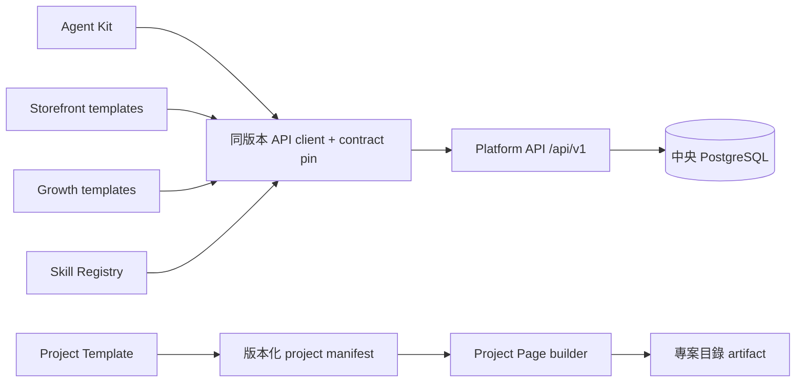

# Repo 分工與模板串接

目前依大計畫 §4 分倉：中央 domain commands 與資料保留在 Platform；可維護／fork 的產品模板獨立。會員定位、供貨與 Guild 不各複製一套 DB。

| Repo | 本輪內容／資料接點 |
| --- | --- |
| freedom-platform | 會員、定位、公會、供貨、零售、作品、行銷 canonical commands；32 個 preview operations、OpenAPI／SDK 及中央 PostgreSQL |
| freedom-agent-kit | 共用 protocol／client、CLI 會員工作摘要、各 AI 工具 adapter 說明；不複製工作資料 |
| freedom-storefront | master-store／catalog-store／single-product／service-offer 模板，店主 API helper、靜態內部預覽；service-offer API 尚未接入 |
| freedom-growth-automation | 草稿／分享 API helper、來源固定的文案與 LINE 格式本機預覽；正式發布／media 執行待接 |
| freedom-skill-registry | declaration index、文件型 skill starter、GitHub project import client；不是第二份會員／作品 DB |
| freedom-project-template | 新專案可運行骨架、測試與身分初始化指引 |
| freedom-project-page | 公開 manifest 的固定介紹頁 builder；不宣稱 signed status／official |
| FreeTWAI.github.io | 九倉專案目錄來源與靜態 build；2026-10-13 repo 改名後 Pages 設定為 `https://freetwai.github.io/`，目錄內容與跨倉來源更新仍需另行驗證 |
| .github | 社群模板、共用驗證 workflow；中央 ruleset 強制執行尚未配置，不宣稱已有管理員 gate |



## 可重跑的串接

Core 的 `tests/integration/repositories.test.ts` 啟動真正的 HTTP API 與唯一 PostgreSQL 測試 schema，再從其他 repo 匯入它們自己的 SDK/helper，驗證選品→供貨回覆、商品→行銷來源、作品→行銷版本與介紹頁。GitHub 對外 response 在該 suite 用明示 fixture；不能把這個 fixture 稱為 provider live 驗收。另已有 staging 真 GitHub import 證據。

```sh
npm run contracts:build
npm test
FREEDOM_REPOSITORIES_ROOT=/absolute/path/to/consumer-checkouts node scripts/checkout-repositories.mjs
FREEDOM_REPOSITORIES_ROOT=/absolute/path/to/consumer-checkouts npm run test:repos
```

`repositories.lock.json` 記錄跨倉實測的 exact commits；CI 下載固定 commits，不能偷偷測各倉最新 main。Consumer `contracts.lock.json` 反向 pin 中央協定的確切 commit/hash；支援程式與事件 schema 都只有一處 authoring source。

## Auth 與副作用邊界

32-operation preview SDK 仍使用會員 session；Node demo login 只接受 HTTP loopback 及已播種的三個假帳號，CLI 不輸出 session cookie／CSRF。2026-09-23 另已加入 [外部客戶端讀取接線](client-read-connections.md)：商店／供應端經本人在平台批准取得七天、可撤銷的 scoped bearer，只讀核准資源，不可寫入、讀會員聯絡或當 browser session。這兩種接線要分清楚。瀏覽器仍沿用同源 Portal，不放寬 CORS。完整 Store purpose token、Agent ExecutionGrant 與 growth leased Job API 仍待開發，不能拿會員 demo session 當 production service account。

寫入需本人已有 authority、明確重送 key 與原版本。409／412 要重新讀取確認；來源 snapshots 不被後續供貨改價或 GitHub 更新覆寫。事件 transport、provider publication、結帳與金流沒有因檔案放入 repo 就啟用。

各 repo 使用真實 GitHub repository／owner ID；copy template 後必須重新初始化 project identity。程式碼授權目前 NOASSERTION，沒有本輪自行新增的授權條款。公開 source、template flag、CI green 和 official／正式發布是不同事實。

## 2026-10-13 FreeTWAI 組織搬遷候選

34 個 repo 已從 Legacy 轉到 FreeTWAI，repository IDs 未變；新 org ID 是
`342048686`，不能沿用舊 owner ID。Pages repo ID `1378081698` 保留，名稱改為
`FreeTWAI/FreeTWAI.github.io`。這節描述程式與資料搬遷候選，不代表平台已部署。

Live API／App 註冊／CSP、會員開發權限、GitHub 活動、maintainer org、公開技能書原始
repo 與導覽索引均改用 FreeTWAI。顯示與同步共用 architecture transport，避免從
歷史 `repositories.lock.json` 重建舊 owner。原作者的 upstream URL／固定 source commit
仍保留；本輪不接納被重新註冊的舊 namespace 或同名不同 ID repo。

Migration166 以已轉移的 34 個名稱／ID 清單移動 live coordinates：

- Pages 的舊 owner／舊名稱和搬遷中途 `FreeTWAI/FreeTWAI-AI.github.io` 都收斂到
  `FreeTWAI/FreeTWAI.github.io`；三鍵同時存在也合併，不接受其他名稱或不同 ID。
- Issue／PR 鍵碰撞取較新的 `updated_at`／`synced_at`，完全相同時保留新鍵；重啟
  URL 相關 backfill／ETag，既有 history 在遷移後仍可讀。
- Metrics 保留最近有效 snapshot；Star support 合併最早確認與最近狀態，不重複計數。
- Canonical／catalog／development grant／maintainer／OSS current project 需 ID 相符才改名；
  權限、到期、撤銷、來源作者不變。舊 installation ID 由新 org 的 App reconcile 刷新，
  不在 SQL 裡硬寫跨環境 ID。
- 既有 migration1–165、audit／claim／OSS version／campaign snapshots、credential AAD、
  signed release bytes、consumer pins／repository lock 全部保留。公開 event feed 是 mutable
  projection，平台 repo 的事件連結改為新 URL。

歷史 pin 接受原記錄的 owner 名稱，但 transport 只映射有限的已審核中央／consumer repo；
來源 SHA／profile／hash／signer scope 仍精確比對。Directory renderer 的固定版本本來
要求舊 organization，該版本的 reference bytes 和反例 fixture 保留，不能把變更原資料
當成這個歷史版本通過的證據。其他 repo 的當前 manifest／workflow／Pages data 更新是
跨倉後續工作，需由各倉審查再更新 reviewed baseline，不換 pin 掩蓋版本差異。

CI 本輪去重：`ci.governance-unit` 留在必跑 source-integrity，consumer job 刪去重複執行；
六片 runtime-full 的 shared sharding integration 只在 partition0 跑一次，各片實際 runtime、
必要 prerequisite 與 aggregate 全保留；checkout script 已取得 exact adopted source object，
故移除額外固定 SHA fetch。任一必要結果 missing／failure／cancelled 仍不能通過 verify。

發布沿 #234 現行凍結與審查狀態，操作前用同一 approved source 準備可還原備份及私有 overlay。
先 staging，阻止舊 org 的 sync／cron writer 並等待現有交易結束，再用現有 migrator 的單一
transaction 套166；部署同一來源的平台與 maintainer Worker，overlay org 也必須是 FreeTWAI。
確認 schema ledger、repo ID、App installation reconcile、sync／history、技能書／原作連結、
開發權限與後台 App callback，完成 staging 驗證後再做 production。
需要真實登入／provider 操作的流程使用經同意的帳號；本機 mock 不能代替它們。

不要只回滾到使用舊 owner 的 binary：它會重新寫回舊鍵並失去新 history 的讀取。
回退需保留 FreeTWAI 座標支援，或在停止新寫入後由 operator 依備份／ledger 處理；
本 migration 不提供自動反向改名。Repo main-baseline ruleset25011111 已恢復基本 PR／
verify／CodeQL 保護。Free plan 採用 CODEOWNERS＋維護者審查：CI 控制檔案與必要設定
由 teddashh／detna-vibe-coding 負責，一位合格的非作者維護者核准即可；一般 UI 改動
不套整倉 owner gate。先正常 CI／review 合併 CODEOWNERS 到 base，再由維護者啟用
require_code_owner_review 並讀回確認，保留最新提交、獨立 review 與必要 checks。
普通 required check 和審查不等於舊 Enterprise 的 immutable workflow enforcement；
candidate 程式仍在 runner 執行，也不宣稱測試不可偽造。保證範圍見
[governance 說明](../../governance/README.md#github-free-repository-ci-review)。
12 份 consumer repo 保護設定仍只是另案提案，本輪中央 bootstrap 不套用它們。
